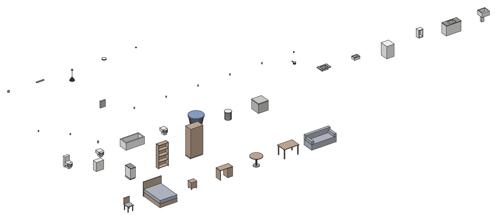

# ConstructCAD Components

[](https://github.com/francisreboucas/constructcad-components/actions/workflows/validate.yml)
[](LICENSE)

A free library of parametric components for [ConstructCAD](https://github.com/francisreboucas/constructcad): furniture, casework, plumbing fixtures, electrical devices, lighting and planting, ready to load into any project.

[Português (Brasil)](README.pt-BR.md) · [Catalog](CATALOG.md) · [Contributing](CONTRIBUTING.md)



## Using a component

1. Download a `.ccomp` file from [`components/`](components) (browse them in the [catalog](CATALOG.md)), or download the whole library as a ZIP from the [latest release](https://github.com/francisreboucas/constructcad-components/releases/latest).
2. In ConstructCAD, load it: the component and all its types join the project, with any materials the project lacks.
   From the command line or a macro:

   ```sh
   ccad -p house.ccad --save run component_load path=components/plumbing/pia-cozinha.ccomp
   ```

3. Place it with the component tool, or `component_place type="Pia cozinha 150 cm" position=[2,3]`.

Each file holds one component with several types (sizes). Types share the geometry and differ in parameter values (`Largura`, `Profundidade`, `Altura`…), which you can change after loading.

## What is in it

| Folder | Contents |
|---|---|
| [`furniture`](components/furniture) | Tables, chairs, beds, sofas, desks, nightstands |
| [`casework`](components/casework) | Wardrobes, kitchen base and wall cabinets, shelving |
| [`plumbing`](components/plumbing) | Toilets, basins, sinks, showers, laundry tubs, washing machines, bathtubs, urinals, bidets, water tanks, inspection and grease boxes |
| [`electrical`](components/electrical) | General and dedicated outlets, shower points, switches, distribution boards, data/TV points |
| [`lighting`](components/lighting) | Ceiling, pendant, recessed, linear and wall lights |
| [`planting`](components/planting) | Trees, conifers, palms, shrubs and potted plants for landscaping |
| [`doors`](components/doors) | Single and double swing, pivot, folding, glass and sliding doors, glazed sliding doors, garage doors |
| [`windows`](components/windows) | Sliding (also with shutters), casement, awning, hopper and fixed windows |

Plumbing fixtures carry their drainage fixture units (NBR 8160) and supply weights (NBR 5626), and electrical devices their device kind and load in VA (NBR 5410), so ConstructCAD sizes pipes and circuits with them. Names and descriptions are in Brazilian Portuguese, following the standards they cite.

## How the library is built

Components are written as readable JSON in [`sources/`](sources), in the shape of the engine's `component_create` command. [`tools/build.py`](tools/build.py) has ConstructCAD's own command line (`ccad`) create each component and save it as `.ccomp`, then loads every file back into a new project to validate it, and writes [`catalog.json`](catalog.json) and [`CATALOG.md`](CATALOG.md). CI runs the same check on every pull request with the pinned ConstructCAD release.

```sh
python tools/build.py --ccad path/to/ccad          # build, validate, update the catalog
python tools/build.py --ccad path/to/ccad --check  # verify only (CI)
```

A `.ccomp` saved from the app (`component_save`) can also be added directly under `components/`, without a source; it is validated and cataloged the same way.

The planting sources are generated: [`tools/vegetation.py`](tools/vegetation.py) grows each species as a mesh (branches by space colonization, foliage clumps, palm fronds) and writes `sources/planting/`. Edit the generator and run it before `build.py`, not the JSON.

## Compatibility

`.ccomp` format version 1, built with ConstructCAD 0.6.0. Files load in ConstructCAD 0.6.0 and later (doors and windows need 0.6.0; in 0.5.0 the other components load without their connectors).

## License

The components are licensed under [Creative Commons Attribution 4.0](LICENSE): use them in any project, commercial or not; if you redistribute the library or derived components, credit "ConstructCAD Components contributors".
